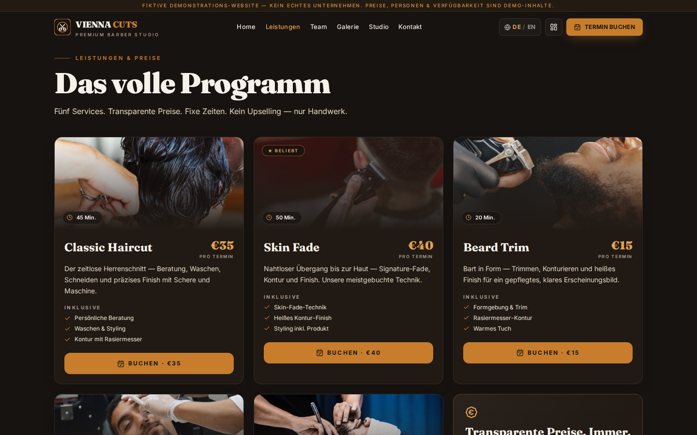
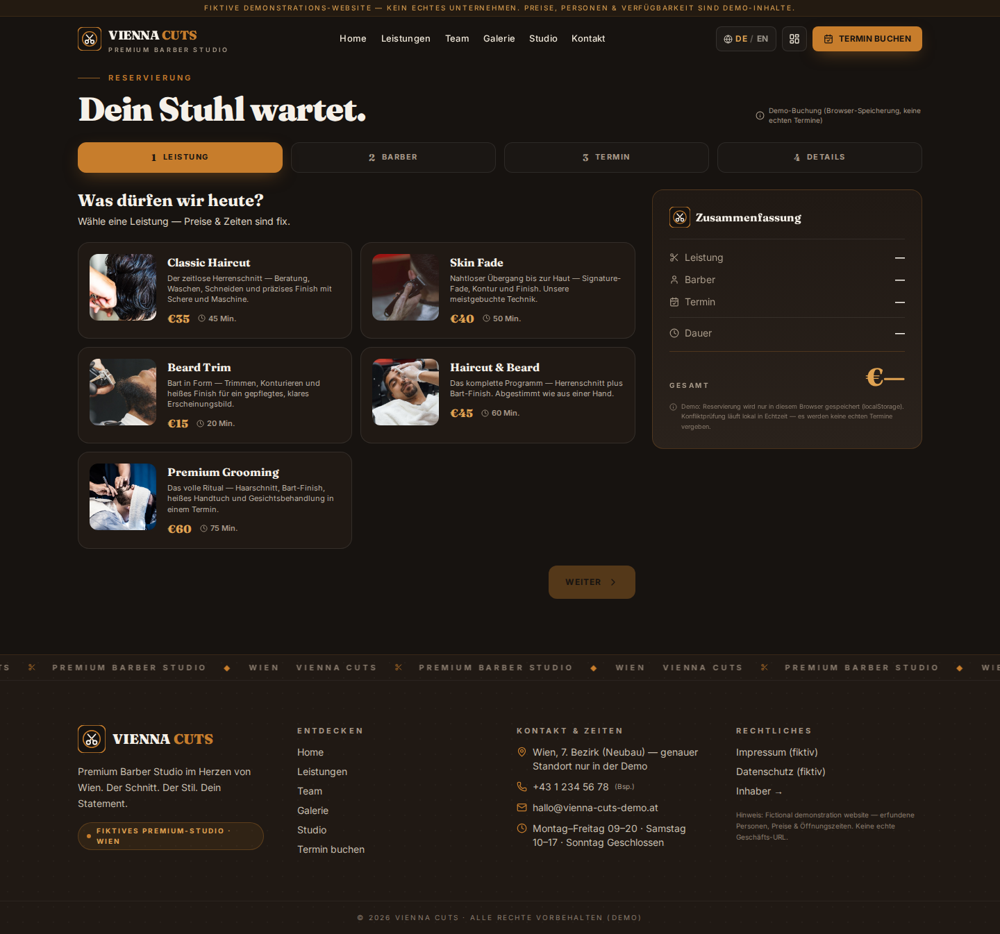
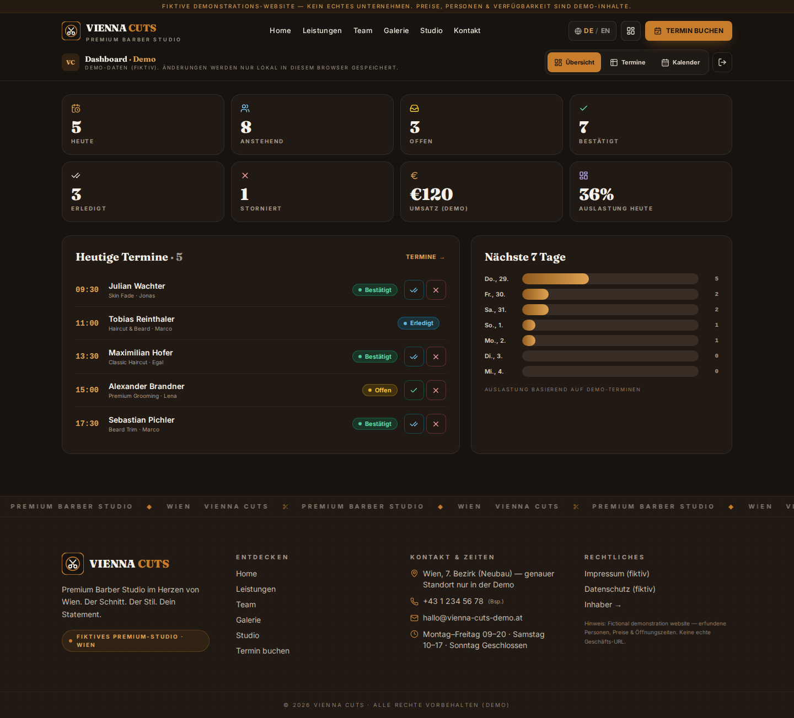

# Vienna Cuts — Booking Demo with Optional AI Receptionist

A bilingual German/English fictional barbershop application with service selection, appointment availability and an owner dashboard. It runs locally without a backend; Supabase, Stripe, Resend and Vapi integrations require separate configuration.

[](https://github.com/ayanirfan099/demo2-barber/actions/workflows/ci.yml)


**[View the demo](https://demo2-barber-jade.vercel.app)** — homepage returned HTTP 200 with Vienna Cuts branding on 1 November 2026. This verifies the page, not live booking, payment, email or voice operation. Use fictional details only.

## Quick start

Node.js 22 and npm:

```sh
npm ci
cp .env.example .env.local
# For offline demo mode, leave VITE_SUPABASE_URL and VITE_SUPABASE_PUBLISHABLE_KEY empty.
npm run dev
```

Open the URL printed by Vite. The example values are placeholders, not working services. Without Supabase configuration, appointments are stored in this browser's localStorage, with fictional seed records. The offline owner login is a demonstration gate, not server authentication. Clear browser storage to reset it.

## Capabilities and architecture

| Layer | Implemented behavior | Boundary |
| --- | --- | --- |
| React 19, TypeScript, Vite, Tailwind | DE/EN pages, hash routing, booking steps, owner views | Fictional business, people, reviews and prices |
| `src/lib/store.ts` | Working hours, lead time, overlap checks, localStorage fallback | Client-side checks do not provide atomic cross-client booking guarantees |
| Supabase | Optional shared bookings and owner Auth session | Requires separately provisioned schema, RLS and owner authorization review; no deploy-ready migrations bundled |
| `api/create-checkout.ts` | Optional Stripe Checkout session | Amount and redirects currently originate from request data; needs trusted server pricing and origin validation |
| `api/stripe-webhook.ts`, `api/resend-email.ts` | Signature-checked Stripe events and optional Resend confirmation | Webhook idempotency, reliable delivery and owner-role authorization require review |
| `/ai`, `api/ai-tools.ts` | Vapi browser voice UI and service/availability/booking tools | Requires assistant configuration and server tool secret; no paid calls are used in tests |

Vite serves the frontend only. The `api/` handlers target Vercel serverless functions and are not started by `npm run dev`. A static frontend build alone does not provide those endpoints.

## Screenshots

These are existing committed captures, not a new verification of every integration.

| Mobile homepage | Services |
| --- | --- |
|  |  |

| Booking | Owner dashboard |
| --- | --- |
|  |  |

## Configuration

Copy `.env.example` locally; never commit real values. Only `VITE_*` and `NEXT_PUBLIC_*` variables are browser-visible. Never put secret/service-role keys in either prefix.

- Browser: `VITE_SUPABASE_URL`, `VITE_SUPABASE_PUBLISHABLE_KEY`; optional `VITE_VAPI_PUBLIC_KEY`, `VITE_VAPI_ASSISTANT_ID`.
- Server only: `SUPABASE_SECRET_KEY`, `STRIPE_SECRET_KEY`, `STRIPE_WEBHOOK_SECRET`, `RESEND_API_KEY`, `VAPI_TOOL_SECRET`. Supply `SUPABASE_URL` or the existing Vite URL on the server as required by the handlers.
- Voice callbacks also use `SITE_URL`; configure an approved demo origin and tool secret before enabling callbacks. Do not enable public write tools with an empty secret.

Production requires atomic database constraints, least-privilege RLS and explicit owner roles, endpoint authorization, validated prices/redirects, abuse controls, webhook idempotency handling, appropriate legal notices, deletion/retention procedures and verified asset rights. Existing handlers and legal copy do not establish those guarantees. Do not collect real customer records or accept real payments as part of this demo.

## Checks

```sh
npm ci
npm run lint
npm test
npm run typecheck
npm run build
```

Vitest covers closed/past slots, overlapping and duplicate local bookings, cancellation, any-barber assignment, and real-header language/navigation behavior. Tests forbid fetch calls and mock Supabase. CI uses the lockfile and runs the same checks. See [cleanup and verification](docs/portfolio-cleanup.md) for baseline lint failures; a badge reports workflow status.

## Rights

This is an original fictional demonstration, not an operating shop or an endorsement. Asset-specific rights and provenance must be confirmed before reuse. No blanket license is added for code, photographs, fonts, trademarks or generated/third-party assets. Dependencies retain their respective licenses.
